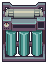
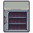
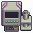

# Machine breakpoints

The total % a machine needs (from all its modules) for each step up. Between steps, more % does nothing.

           

##  Moisture Farm

**Quality** sets the water grade. **Performance** makes more water: 850 ml a day, +1% per 1% (farms running the same night share the air).

##  Water Purifier

**Quality** sets how clean the water can get. **Performance** cleans faster: +1% per 1% (dirty water up to 20 times faster).

##  Furnace

**Quality** raises ingot purity one stage per full 100%, up to Perfect. **Performance** does nothing. Purity by recipe and Quality:

**Without Blast** (1 ingot from 2 materials)

| Recipe | 0% | 100% | 200% | 300% | 400% |
|---|---|---|---|---|---|
| **2 scrap** | Low | Fair | High | Very High | **Perfect** |
| **1 scrap + 1 ore** | Fair | High | Very High | **Perfect** | **Perfect** |
| **2 ore** | High | Very High | **Perfect** | **Perfect** | **Perfect** |

**With a Blast module** (2 ingots from 3 materials, one stage less)

| Recipe | 0% | 100% | 200% | 300% | 400% | 500% |
|---|---|---|---|---|---|---|
| **3 scrap** | Very Low | Low | Fair | High | Very High | **Perfect** |
| **2 scrap + 1 ore** | Very Low | Low | Fair | High | Very High | **Perfect** |
| **1 scrap + 2 ore** | Low | Fair | High | Very High | **Perfect** | **Perfect** |
| **3 ore** | Fair | High | Very High | **Perfect** | **Perfect** | **Perfect** |

##  AgeWell

**Quality** ages wine extra days each night. **Performance** lowers energy use, like Efficiency.

##  Mirage Projector

No breakpoints: attractiveness is **100 points + 1 per 2% Quality + 1 per 4% Performance**. Projectors do not stack; the best one counts.

##  Alarm System

**Performance** raises the chance to stop a theft. The game shows 50% + Performance, but it rolls one point in your favour, so **49%** already stops every theft. Only one alarm counts.

##  Cryptographic Desequencer

**Performance** decodes faster: 33 work a day, +1 per ~3% Performance. Cells are the Performance % for that many days. **Quality** does nothing.

| Keycard | Work | 5d | 4d | 3d | 2d | 1d |
|---|---|---|---|---|---|---|
| **Service/Supply** | 75 |  |  | 0% | 16% | 128% |
| **Engineering/Medical** | 100 |  | 0% | 4% | 52% | 204% |
| **Security** | 125 |  | 0% | 28% | 91% | 279% |
| **Command** | 150 | 0% | 16% | 52% | 128% | 355% |

##  Hydroponic System

Plain seeds, their innate traits included (a seed changed in the DNA Manipulator differs; the optimizer reads yours from the save).

**Growth:** 8 work a day, +1 per full 25% Performance. Cells are the Performance % to grow in that many days.

| Plant | Work | 6d | 5d | 4d | 3d | 2d | 1d |
|---|---|---|---|---|---|---|---|
| **Fillerweed** | 8 |  |  |  |  |  | 0% |
| **Hydroreed** | 18 |  |  |  | 0% | 25% | 250% |
| **Bloomberry** | 22 |  |  |  | 0% | 75% | 350% |
| **Bloomberry regrowth** | 12 |  |  |  |  | 0% | 100% |
| **Coffee** | 21 |  |  |  | 0% | 75% | 325% |
| **Nutrifruit** | 16 |  |  |  |  | 0% | 200% |
| **Dream Cap** | 28 |  |  | 0% | 50% | 150% | 500% |
| **Kotton** | 43 | 0% | 25% | 75% | 175% | 350% | 875% |

**Harvest:** +1% items per 2% Quality, rounded. Cells are the Quality % for each extra item.

| Plant | Items | +1 | +2 | +3 | +4 | Note |
|---|---|---|---|---|---|---|
| **Fillerweed** | 5 | 20% | 60% | 100% | 140% |  |
| **Bloomberry** | 6 | 18% | 50% | 84% | 118% |  |
| **Bloomberry regrowth** | 6 | 18% | 50% | 84% | 118% |  |
| **Coffee** | 8 | 14% | 38% | 64% | 88% |  |
| **Nutrifruit** | 7 | 16% | 44% | 72% | 100% | all Huge from 102% |
| **Dream Cap** | 8 | 14% | 38% | 64% | 88% |  |
| **Kotton** | 13 | 8% | 24% | 40% | 54% |  |

Good to know (MachineHydroponic, HydroponicHelper, PlantHarvest):

- The module bay is **locked while a plant grows**; modules can only be changed between harvests.
- Each work point uses nutrients and takes contaminant damage, so more Performance uses more a day but the same per grow; water is used once a day, so a faster grow uses less.
- Plant health above 70% keeps the full harvest (higher health gives bigger produce). At 70% or less, Kotton, Dream Cap and Coffee lose part of the harvest, after Quality.
- Nutrifruit is all Huge at 100% health, and at 96-99% health from 102% Quality (half Huge below it). Module bonuses (Nutrifruit, Dream Cap, Fillerweed modules) add items after Quality.

##  DNA Manipulator

**Performance:** 10 work a day, +1 per full 20%. An operation at complexity c needs 20 + 4c work. **Quality:** success is 95 − 5c + Quality / 2 %.

| Complexity | Work | Success at 0% | 100% success at | 8d | 7d | 6d | 5d | 4d | 3d | 2d | 1d |
|---|---|---|---|---|---|---|---|---|---|---|---|
| **0** | 20 | 95% | **10%** |  |  |  |  |  |  | 0% | 200% |
| **1** | 24 | 90% | **20%** |  |  |  |  |  | 0% | 40% | 280% |
| **2** | 28 | 85% | **30%** |  |  |  |  |  | 0% | 80% | 360% |
| **3** | 32 | 80% | **40%** |  |  |  |  | 0% | 20% | 120% | 440% |
| **4** | 36 | 75% | **50%** |  |  |  |  | 0% | 40% | 160% | 520% |
| **5** | 40 | 70% | **60%** |  |  |  |  | 0% | 80% | 200% | 600% |
| **6** | 44 | 65% | **70%** |  |  |  | 0% | 20% | 100% | 240% | 680% |
| **7** | 48 | 60% | **80%** |  |  |  | 0% | 40% | 120% | 280% | 760% |
| **8** | 52 | 55% | **90%** |  |  | 0% | 20% | 60% | 160% | 320% | 840% |
| **9** | 56 | 50% | **100%** |  |  | 0% | 40% | 80% | 180% | 360% | 920% |
| **10** | 60 | 45% | **110%** |  |  | 0% | 40% | 100% | 200% | 400% | 1000% |
| **11** | 64 | 40% | **120%** |  | 0% | 20% | 60% | 120% | 240% | 440% | 1080% |
| **12** | 68 | 35% | **130%** |  | 0% | 40% | 80% | 140% | 260% | 480% | 1160% |
| **13** | 72 | 30% | **140%** | 0% | 20% | 40% | 100% | 160% | 280% | 520% | 1240% |
| **14** | 76 | 25% | **150%** | 0% | 20% | 60% | 120% | 180% | 320% | 560% | 1320% |
| **15** | 80 | 20% | **160%** | 0% | 40% | 80% | 120% | 200% | 340% | 600% | 1400% |

Good to know (MachineDnaManipulator, PlantGeneticsHelper):

- Complexity is the seed's own (traits changed from the plant's innate ones, plus Complex / Simple Genome: +4 / −4 per rank) **plus its heat**. A plain Nutrifruit starts at **8** (Complex Genome 2), and the freed strain, without its innate Infertile ×10, at **18**; a plain Fillerweed counts as 0. The optimizer reads the seed in your DNA Manipulator from the save; with no seed there it maximizes both stats without steps.
- Every operation, success or not, adds heat (2 + the trait's complexity), so each further edit on the same seed is slower and harder.
- Work and success are fixed when the operation starts; the module bay is locked until it ends.

##  3D Printer

**Performance:** 24 work a day, +1 per ~4.2% Performance. Chips of 24 work or less (scopes, lasers, suppressor, .22 mags, small parts) take 1 day.

| Chip | Work | 5d | 4d | 3d | 2d | 1d |
|---|---|---|---|---|---|---|
| **Gun Parts** | 30 |  |  |  | 0% | 25% |
| **Box Cutter** | 34 |  |  |  | 0% | 42% |
| **High Cap. .22 Mag.** | 36 |  |  |  | 0% | 50% |
| **10mm Magazine** | 36 |  |  |  | 0% | 50% |
| **Ext. .22 Mag.** | 48 |  |  |  | 0% | 100% |
| **High Cap. 10mm Mag.** | 48 |  |  |  | 0% | 100% |
| **.22 Pistol** | 50 |  |  | 0% | 5% | 109% |
| **.22 Pistol x2** | 60 |  |  | 0% | 25% | 150% |
| **Nestfire Compact Frame** | 60 |  |  | 0% | 25% | 150% |
| **Ext. 10mm Mag.** | 60 |  |  | 0% | 25% | 150% |
| **Kitchen Knife** | 64 |  |  | 0% | 34% | 167% |
| **Ironcraft 10 Frame** | 70 |  |  | 0% | 46% | 192% |
| **Hatchet** | 75 |  | 0% | 5% | 59% | 213% |
| **Meat Cleaver** | 82 |  | 0% | 17% | 71% | 242% |
| **Combat Knife** | 98 | 0% | 5% | 38% | 105% | 309% |
| **Combat Machete** | 120 | 0% | 25% | 67% | 150% | 400% |

**Quality** sets a printed melee weapon's condition: it rolls 20-30 + Quality / 4 (+ the ingot's quality bonus).

| Quality | 20% | 160% | 280% |
|---|---|---|---|
| **Condition** | Fair or better | Good or better | Excellent |

**Combat Knife and Combat Machete** are printed from ingots, whose purity adds to the roll. Quality for a sure condition:

| Ingot purity | Bonus | Fair or better | Good or better | Excellent |
|---|---|---|---|---|
| **Very Low** | -30 | 140% | 280% | 400% |
| **Low** | -20 | 100% | 240% | 360% |
| **Fair** | 0 | 20% | 160% | 280% |
| **High** | +20 | always | 80% | 200% |
| **Very High** | +30 | always | 40% | 160% |
| **Perfect** | +100 | always | always | always |

Good to know (MachinePrinter):

- Gun frames (Nestfire, Ironcraft) make a gun with firepower and style × (1 + (Quality / 4 + the ingot bonus) / 100); printed pistols × (1 + Quality / 4 / 100). No breakpoints there: every % counts.
- Gun Parts: the ingot's purity sets how many you get: Very Low 2, Low or Fair 3, High or Very High 4, Perfect 5.
- Each Melee Batch module prints one more melee weapon per chip run.
- The module bay is **locked while printing**.

##  Deal Maker

No breakpoints: **Quality** adds 1% accept chance on a haggle per 10% (10% to start). **Performance** lowers energy use, like Efficiency.

Good to know (MachineDealMaker, BargainUIManager): you activate it by hand, once per customer, and it uses its energy then. The bonus adds straight to the accept chance: a markup is accepted at 100 − 2 × markup % + faction reputation + the bonus, so every +10% Quality allows +0.5% markup at the same odds. Blackmail is 60% + reputation + the bonus.

##  Evaporator

**Quality** is the share of what evaporates that you keep, up to 100%. **Performance** evaporates more: 300 ml a day, +1% per 1%. With the Solvent Recovery module only alcohol is kept.

Good to know (MachineEvaporator, Liquid): only water, alcohol and lipobond agent evaporate, taken from the container in proportion to how much of each it holds; everything else stays and gets more concentrated. What is kept goes into the container in the distillate slot (none there, nothing kept).

## Energy

**Efficiency** lowers every machine's energy use, one point at a time, never below 1. On the AgeWell and the Deal Maker, Performance counts too.

| Machine | Energy | −1 for every |
|---|---|---|
| Water Purifier, Alarm System | 4 a day | full 25% |
| Moisture Farm, Evaporator | 6 a day | ~16.7% |
| Furnace, Hydroponic, 3D Printer | 8 a day | full 12.5% |
| Desequencer | 10 a day | full 10% |
| DNA Manipulator | 12 a day | ~8.3% |
| Mirage Projector | 16 a day | full 6.25% |
| AgeWell | 24 a day | ~8.3% of Efficiency and Performance together |
| Deal Maker | 25 a use | full 4% of Efficiency and Performance together |

---

Generated from the optimizer's own rules (`grid-optimizer/src/machineDefaults.ts`, checked against the game's code) by `npm run breakpoints`. Do not edit by hand.
