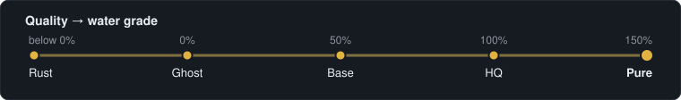
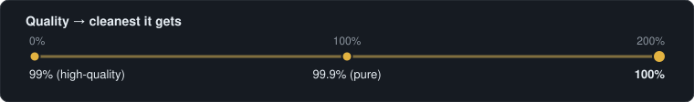
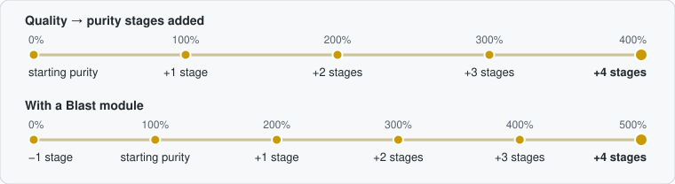
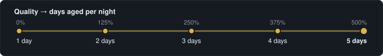
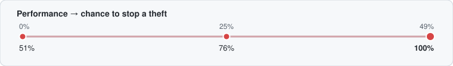
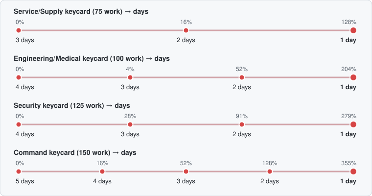
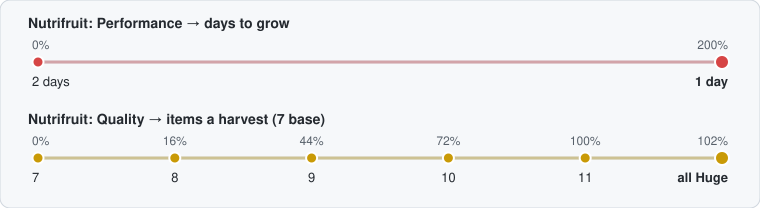
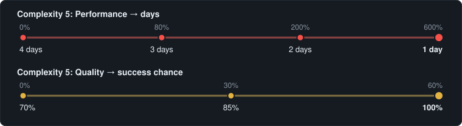
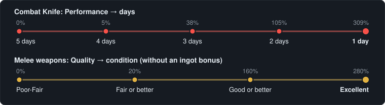
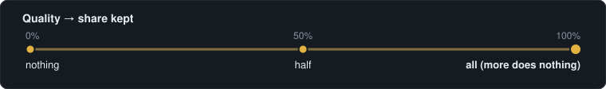

# Machine breakpoints

A breakpoint is the **total %** (what a machine's stat card shows, from all its modules) where the machine gets better at something.
Between two breakpoints, more % does nothing. Ticks are in order, not to scale.

           

##  Moisture Farm

**Quality** sets the water grade. **Performance** makes more water: 850 ml a day, +1% per 1% (farms running the same night share the air).

##  Water Purifier

**Quality** sets how clean the water can get. **Performance** cleans faster: +1% per 1% (dirty water up to 20 times faster).

##  Furnace

**Quality** raises ingot purity one stage per full 100%. **Performance** does nothing. A Blast module takes one stage off.
Starting purity depends on the ore in the recipe: 2 ore High, 1 ore Fair, none Low (with Blast: 3 ore High, 2 Fair, 1 or none Low).

Purity per recipe

| Quality | Without Blast |
|---|---|
| **100%** | 2 scrap → Fair Purity · 1 scrap + 1 ore → High Purity · 2 ore → Very High Purity |
| **200%** | 2 scrap → High Purity · 1 scrap + 1 ore → Very High Purity · 2 ore → Perfect Purity |
| **300%** | 2 scrap → Very High Purity · 1 scrap + 1 ore → Perfect Purity · 2 ore → Perfect Purity |
| **400%** | 2 scrap → Perfect Purity · 1 scrap + 1 ore → Perfect Purity · 2 ore → Perfect Purity |

| Quality | With Blast |
|---|---|
| **100%** | 3 scrap → Low Purity · 2 scrap + 1 ore → Low Purity · 1 scrap + 2 ore → Fair Purity · 3 ore → High Purity (Blast: below 100% one stage less, unless flux is used) |
| **200%** | 3 scrap → Fair Purity · 2 scrap + 1 ore → Fair Purity · 1 scrap + 2 ore → High Purity · 3 ore → Very High Purity (Blast: first 100% ignored) |
| **300%** | 3 scrap → High Purity · 2 scrap + 1 ore → High Purity · 1 scrap + 2 ore → Very High Purity · 3 ore → Perfect Purity (Blast: first 100% ignored) |
| **400%** | 3 scrap → Very High Purity · 2 scrap + 1 ore → Very High Purity · 1 scrap + 2 ore → Perfect Purity · 3 ore → Perfect Purity (Blast: first 100% ignored) |
| **500%** | 3 scrap → Perfect Purity · 2 scrap + 1 ore → Perfect Purity · 1 scrap + 2 ore → Perfect Purity · 3 ore → Perfect Purity (Blast: first 100% ignored) |

##  AgeWell

**Quality** ages wine extra days each night. **Performance** lowers energy use, like Efficiency.

##  Mirage Projector

No breakpoints: attractiveness is **100 points + 1 per 2% Quality + 1 per 4% Performance**. Projectors do not stack; the best one counts.

##  Alarm System

**Performance** raises the chance to stop a theft. The game shows 50% + Performance, but it rolls one point in your favour, so **49%** already stops every theft. Only one alarm counts.

##  Cryptographic Desequencer

**Performance** decodes keycards faster (33 work a day, +1% per 1%). Each keycard takes whole days, so only these totals matter. **Quality** does nothing.

##  Hydroponic System

**Performance** grows plants in fewer days (8 work a day, +1 per full 25%). **Quality** adds items to each harvest. Every plant has its own steps; Nutrifruit as an example:

Every plant (plain seeds, their innate traits included)

| Plant | Performance → days | Quality → extra items |
|---|---|---|
| Fillerweed | **0%** 1d | **20%** +1 · **60%** +2 · **100%** +3 · **140%** +4 |
| Hydroreed | **0%** 3d · **25%** 2d · **250%** 1d | — |
| Bloomberry | **0%** 3d · **75%** 2d · **350%** 1d | **18%** +1 · **50%** +2 · **84%** +3 · **118%** +4 |
| Bloomberry regrowth | **0%** 2d · **100%** 1d | **18%** +1 · **50%** +2 · **84%** +3 · **118%** +4 |
| Coffee | **0%** 3d · **75%** 2d · **325%** 1d | **14%** +1 · **38%** +2 · **64%** +3 · **88%** +4 |
| Nutrifruit | **0%** 2d · **200%** 1d | **16%** +1 · **44%** +2 · **72%** +3 · **100%** +4 · **102%** Huge |
| Dream Cap | **0%** 4d · **50%** 3d · **150%** 2d · **500%** 1d | **14%** +1 · **38%** +2 · **64%** +3 · **88%** +4 |
| Kotton | **0%** 6d · **25%** 5d · **75%** 4d · **175%** 3d · **350%** 2d · **875%** 1d | **8%** +1 · **24%** +2 · **40%** +3 · **54%** +4 |

##  DNA Manipulator

**Performance** finishes operations in fewer days. **Quality** raises the success chance: 100% at **10 + 10 × complexity**. Complexity 5 as an example:

Every complexity (0-15)

| Complexity | Performance → days | Quality for 100% |
|---|---|---|
| 0 | **0%** 2d · **200%** 1d | **10%** |
| 1 | **0%** 3d · **40%** 2d · **280%** 1d | **20%** |
| 2 | **0%** 3d · **80%** 2d · **360%** 1d | **30%** |
| 3 | **0%** 4d · **20%** 3d · **120%** 2d · **440%** 1d | **40%** |
| 4 | **0%** 4d · **40%** 3d · **160%** 2d · **520%** 1d | **50%** |
| 5 | **0%** 4d · **80%** 3d · **200%** 2d · **600%** 1d | **60%** |
| 6 | **0%** 5d · **20%** 4d · **100%** 3d · **240%** 2d · **680%** 1d | **70%** |
| 7 | **0%** 5d · **40%** 4d · **120%** 3d · **280%** 2d · **760%** 1d | **80%** |
| 8 | **0%** 6d · **20%** 5d · **60%** 4d · **160%** 3d · **320%** 2d · **840%** 1d | **90%** |
| 9 | **0%** 6d · **40%** 5d · **80%** 4d · **180%** 3d · **360%** 2d · **920%** 1d | **100%** |
| 10 | **0%** 6d · **40%** 5d · **100%** 4d · **200%** 3d · **400%** 2d · **1000%** 1d | **110%** |
| 11 | **0%** 7d · **20%** 6d · **60%** 5d · **120%** 4d · **240%** 3d · **440%** 2d · **1080%** 1d | **120%** |
| 12 | **0%** 7d · **40%** 6d · **80%** 5d · **140%** 4d · **260%** 3d · **480%** 2d · **1160%** 1d | **130%** |
| 13 | **0%** 8d · **20%** 7d · **40%** 6d · **100%** 5d · **160%** 4d · **280%** 3d · **520%** 2d · **1240%** 1d | **140%** |
| 14 | **0%** 8d · **20%** 7d · **60%** 6d · **120%** 5d · **180%** 4d · **320%** 3d · **560%** 2d · **1320%** 1d | **150%** |
| 15 | **0%** 8d · **40%** 7d · **80%** 6d · **120%** 5d · **200%** 4d · **340%** 3d · **600%** 2d · **1400%** 1d | **160%** |

##  3D Printer

**Performance** prints in fewer days (24 work a day, +1% per 1%). **Quality** improves printed melee weapons. Combat Knife as an example:

Every chip

| Chip | Performance → days |
|---|---|
| Gun Parts | **0%** 2d · **25%** 1d |
| Box Cutter | **0%** 2d · **42%** 1d |
| High Cap. .22 Mag. | **0%** 2d · **50%** 1d |
| 10mm Magazine | **0%** 2d · **50%** 1d |
| Ext. .22 Mag. | **0%** 2d · **100%** 1d |
| High Cap. 10mm Mag. | **0%** 2d · **100%** 1d |
| .22 Pistol | **0%** 3d · **5%** 2d · **109%** 1d |
| .22 Pistol x2 | **0%** 3d · **25%** 2d · **150%** 1d |
| Nestfire Compact Frame | **0%** 3d · **25%** 2d · **150%** 1d |
| Ext. 10mm Mag. | **0%** 3d · **25%** 2d · **150%** 1d |
| Kitchen Knife | **0%** 3d · **34%** 2d · **167%** 1d |
| Ironcraft 10 Frame | **0%** 3d · **46%** 2d · **192%** 1d |
| Hatchet | **0%** 4d · **5%** 3d · **59%** 2d · **213%** 1d |
| Meat Cleaver | **0%** 4d · **17%** 3d · **71%** 2d · **242%** 1d |
| Combat Knife | **0%** 5d · **5%** 4d · **38%** 3d · **105%** 2d · **309%** 1d |
| Combat Machete | **0%** 5d · **25%** 4d · **67%** 3d · **150%** 2d · **400%** 1d |

##  Deal Maker

No breakpoints: **Quality** adds 1% accept chance on a haggle per 10% (10% to start). **Performance** lowers energy use, like Efficiency.

##  Evaporator

**Quality** is the share of what evaporates that you keep, up to 100%. **Performance** evaporates more: 300 ml a day, +1% per 1%. With the Solvent Recovery module only alcohol is kept.

## Energy

**Efficiency** lowers every machine's energy use, one point at a time, never below 1. On the AgeWell and the Deal Maker, Performance counts too.

| Machine | Energy | −1 for every |
|---|---|---|
| Water Purifier, Alarm System | 4 a day | full 25% |
| Moisture Farm, Evaporator | 6 a day | ~16.7% |
| Furnace, Hydroponic, 3D Printer | 8 a day | full 12.5% |
| Desequencer | 10 a day | full 10% |
| DNA Manipulator | 12 a day | ~8.3% |
| Mirage Projector | 16 a day | full 6.25% |
| AgeWell | 24 a day | ~8.3% of Efficiency and Performance together |
| Deal Maker | 25 a use | full 4% of Efficiency and Performance together |

---

Generated from the optimizer's own rules (`grid-optimizer/src/machineDefaults.ts`, checked against the game's code) by `npm run breakpoints`. Do not edit by hand.
